# offline-shelf

**Ten offline themes for [kiwix-serve](https://github.com/kiwix/kiwix-tools)**, the
server that serves Wikipedia, Project Gutenberg, iFixit and other ZIM archives on your
own network with no internet connection.

Made for home servers, Raspberry Pis and emergency kits: no extra software, no
downloads at runtime, no JavaScript framework. Just CSS and one small script
that kiwix-serve already knows how to serve.

> **Unofficial.** This is a community project. It is not affiliated with or
> endorsed by the Kiwix project.

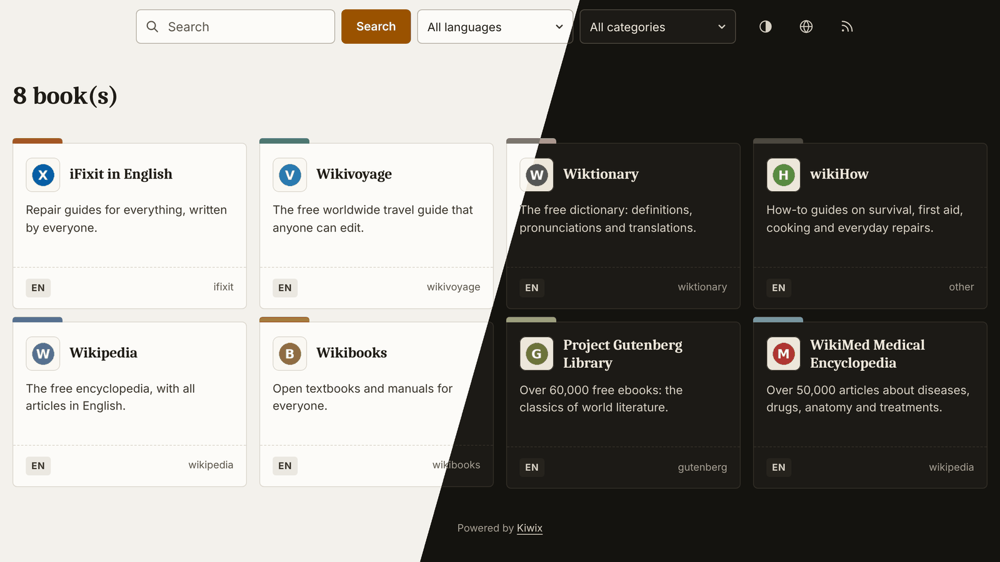

## Features

- **Ten themes, five light and five dark.** Each one restyles the library page
  and the reader toolbar, and every text colour meets WCAG AA contrast.
- **Follows the device.** Pick one light and one dark theme; each phone or
  laptop gets the one that matches its own light or dark setting.
- **Theme menu in the browser.** Anyone on the network can choose a different
  theme for their own device. The server setting stays the default.
- **Built for blackouts.** Works with no internet at all. *Rotlicht* is a
  red-only night mode that keeps your eyes adapted to the dark.
- **Small.** About 56 KB per pack (14 KB gzipped), system fonts only (the stock Kiwix CSS
  alone ships 317 KB of web fonts). Fast on a Raspberry Pi and on old phones.
- **No patching.** No proxy, no fork, no rebuild of Kiwix. One environment
  variable switches it on, removing it switches it off.

## Quick start (Docker)

Clone the repository next to your ZIM files:

```sh
git clone https://github.com/hildlabs/offline-shelf.git
```

Mount the prebuilt packs and point kiwix-serve at one of them:

```yaml
services:
  kiwix:
    image: ghcr.io/kiwix/kiwix-serve:latest
    command: "*.zim"
    ports:
      - "8090:8080"
    volumes:
      - ./zim:/data:ro
      - ./offline-shelf/dist:/themes:ro
    environment:
      # /themes/<light theme>+<dark theme>/resources.txt
      KIWIX_SERVE_CUSTOMIZED_RESOURCES: /themes/papier+lampenlicht/resources.txt
```

Then `docker compose up -d`, open `http://<server>:8090` and reload once with
<kbd>Ctrl</kbd>+<kbd>F5</kbd>. A commented copy is in
[examples/docker-compose.yml](examples/docker-compose.yml).

All 25 light + dark combinations are prebuilt in [dist/](dist/). To go back
to the stock look, remove the variable and recreate the container.

<details>
<summary>Without Docker</summary>

kiwix-serve reads the same variable on any platform. The paths inside each
`resources.txt` must exist on your machine, so build the packs for the folder
you serve them from first:

```sh
tools/kiwix-theme build-all /srv/offline-shelf/dist
KIWIX_SERVE_CUSTOMIZED_RESOURCES=/srv/offline-shelf/dist/papier+lampenlicht/resources.txt \
  kiwix-serve --port 8090 /srv/zim/*.zim
```

</details>

## The themes

Theme names are German, the language of the project's first home. The
English meaning is in brackets.

### Light

| | Theme | Look |
|-|-------|------|
|  | **[Papier](themes/papier/)** (paper) | Warm paper, near-black ink, serif titles, a coloured index tab per collection |
| 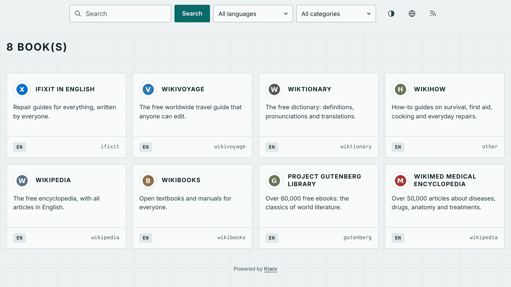 | **[Atlas](themes/atlas/)** | Cool map paper with a faint grid, petrol accent, spaced capitals, monospace details |
| 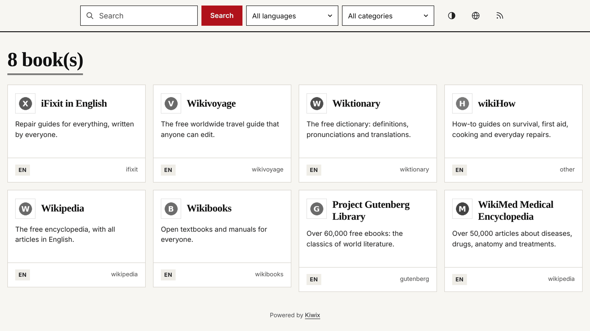 | **[Zeitung](themes/zeitung/)** (newspaper) | Black on white, square corners, heavy serif headlines, red accent, greyscale logos |
| 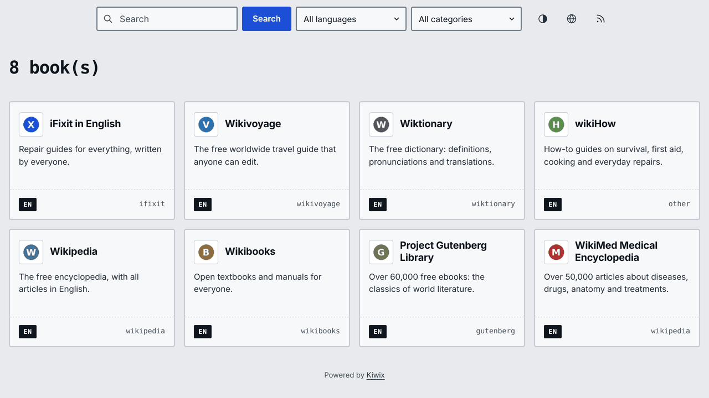 | **[Werkstatt](themes/werkstatt/)** (workshop) | Workshop grey, heavy 2 px outlines, blueprint blue, monospace labels |
| 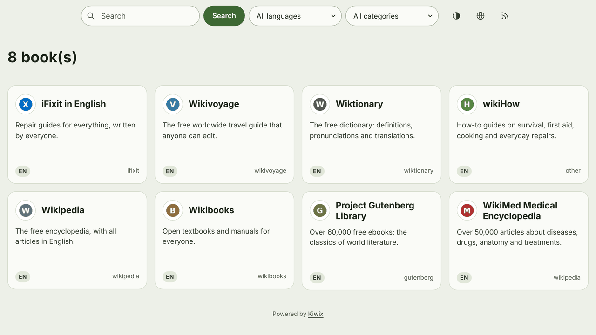 | **[Salbei](themes/salbei/)** (sage) | Sage green, round shapes and logos, rounded type |

### Dark

| | Theme | Look |
|-|-------|------|
| 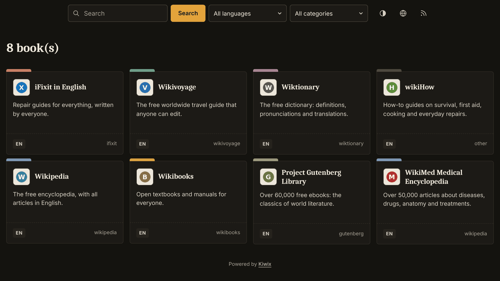 | **[Lampenlicht](themes/lampenlicht/)** (lamplight) | Warm black, cream text, amber accent, coloured index tabs |
|  | **[Bunker](themes/bunker/)** | Phosphor terminal: black and green, monospace everywhere, a blinking cursor |
| 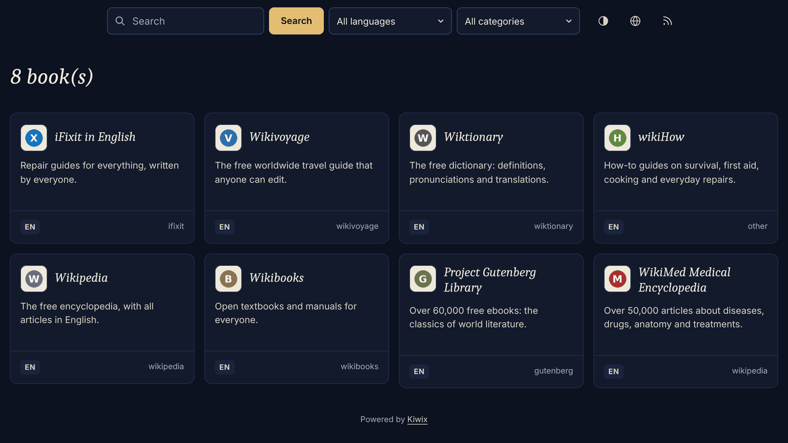 | **[Mitternacht](themes/mitternacht/)** (midnight) | Night blue, ivory text, gold accent, italic serif titles |
| 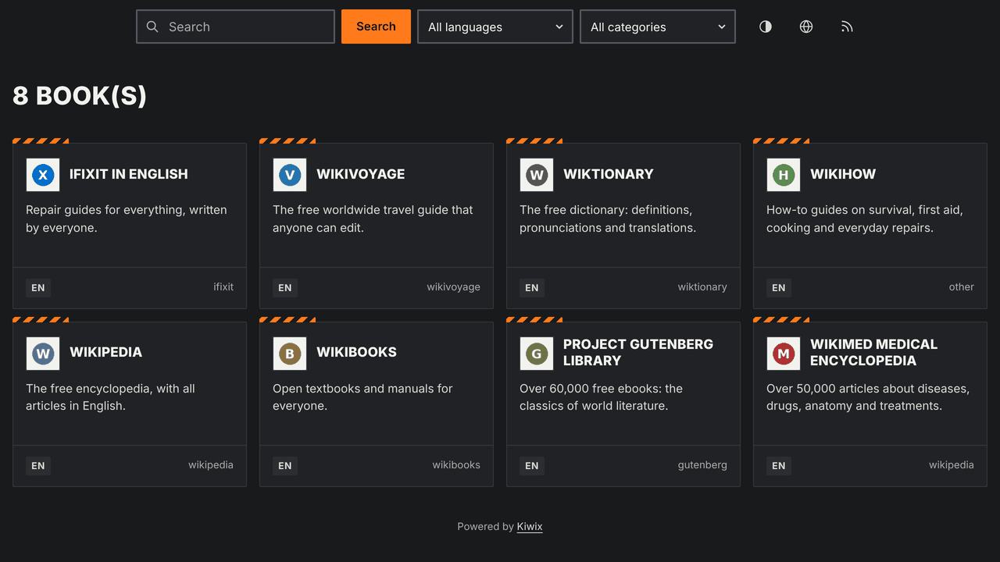 | **[Signal](themes/signal/)** | Charcoal with safety orange, bold capitals, hazard-striped tabs |
| 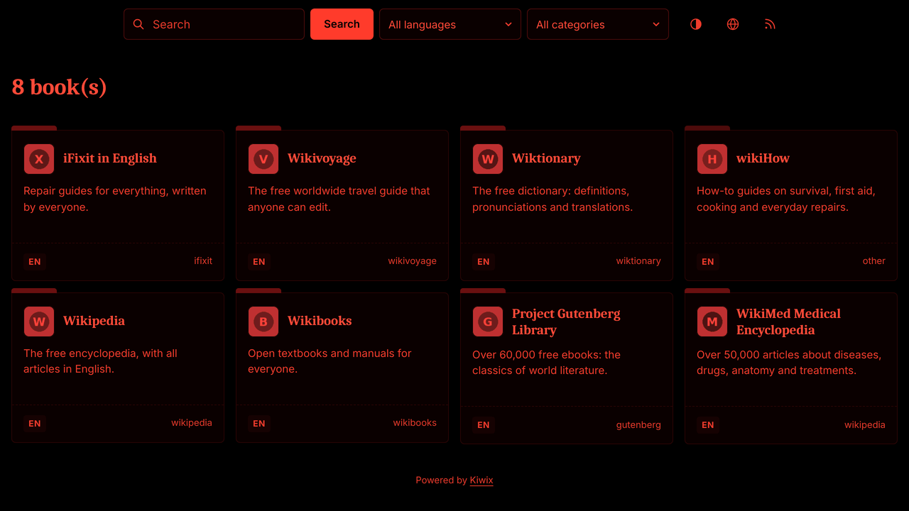 | **[Rotlicht](themes/rotlicht/)** (red light) | Night vision: black and dim red only, the article is tinted red too |

### Reading and phones

The reader toolbar follows the theme too: book title, search, random article,
back to the library.

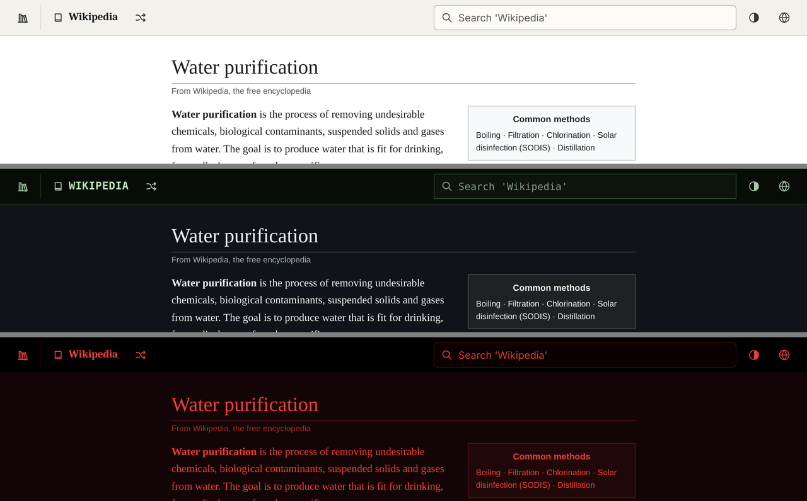

Everything works on small screens, with touch-sized buttons and a toolbar
that gets out of the way while you read.

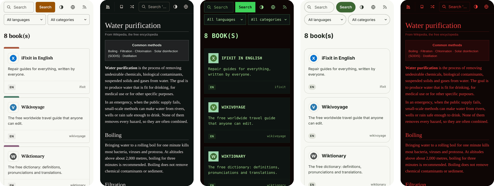

**About the article itself.** The page below the toolbar is the book's own
HTML from the ZIM file. It keeps its own styles and, for most Wikimedia books,
its own dark mode. Themes leave it alone, with one exception: Rotlicht tints
the whole article red with a CSS filter. Books with a dark mode come out dark
red, as above. Books without one come out as a bright red page.

## Choosing a theme

### In the browser, per device

Every pack adds a theme button (the half-filled circle) next to the language
button, in the library and in the reader. It opens one short list:
*Automatic* (the server's pack) and the ten themes. The choice is saved in that
browser only, so a phone can stay on Rotlicht while the tablet keeps Papier.

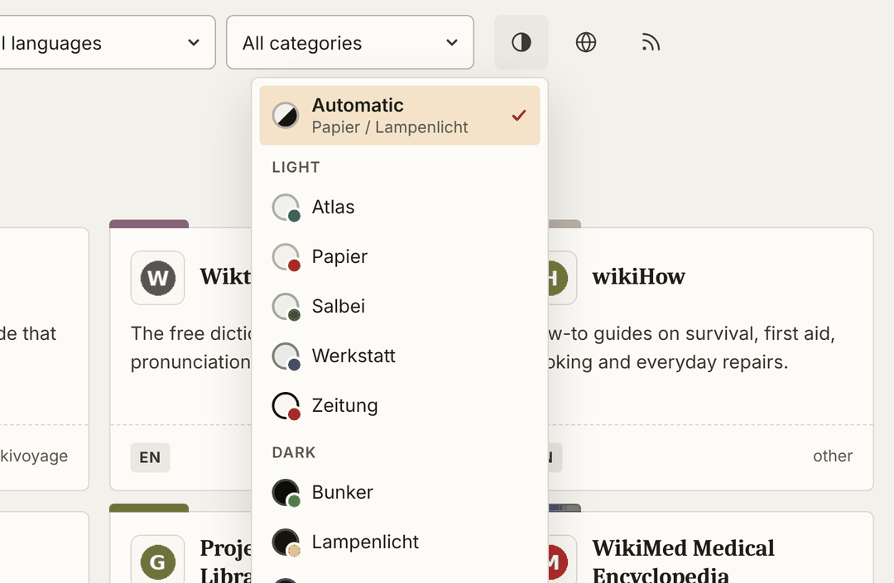

The menu needs no cookie, no account and no extra service. A reload paints
the chosen theme from the very first frame.

### On the server, for everyone

The pack in `KIWIX_SERVE_CUSTOMIZED_RESOURCES` is the default for every
device that has not picked a theme. [examples/theme.sh](examples/theme.sh)
switches it with one command. Copy `dist/` to `./themes/offline-shelf/` next to
your compose file, and use these two lines in it:

```yaml
    volumes:
      - ./themes/offline-shelf:/themes:ro
    environment:
      KIWIX_SERVE_CUSTOMIZED_RESOURCES: /themes/${KIWIX_THEME:-papier+lampenlicht}/resources.txt
```

Then, on the server:

```sh
./theme.sh                    # show the active pack and all themes
./theme.sh zeitung rotlicht   # light theme first, dark theme second
./theme.sh off                # stock Kiwix look
```

The script writes `KIWIX_THEME` to `.env` and recreates the kiwix container,
because kiwix-serve reads the variable only at startup.

## How it works

kiwix-serve has an undocumented environment variable,
`KIWIX_SERVE_CUSTOMIZED_RESOURCES`. It points to a text file in which each
line maps a URL to a local file:

```
/skin/index.css text/css /themes/skin/index.css
```

kiwix-serve then serves that file instead of its built-in one. A pack
replaces:

| URL | Used by | Contents |
|-----|---------|----------|
| `/skin/kiwix.css` | every page | the light and dark theme tokens, base styles |
| `/skin/index.css` | library page | layout of the library |
| `/skin/taskbar.css` | reader | the toolbar above an open book |
| `/skin/polyfills.js` | library and reader | stock file, unchanged, plus the theme menu |
| `/skin/os-theme/<name>.css` | theme menu | each theme on its own, loaded only when chosen |

The layout is written once in [base/](base/). A theme is a single
`themes/<name>/theme.css` that only sets colours, fonts and shapes as CSS
custom properties, plus a few extra rules where it needs them. Details,
measurements and limits are in [docs/how-it-works.md](docs/how-it-works.md).

## Make your own theme

Copy a folder in `themes/`, change the values in its `theme.css`, then:

```sh
tools/kiwix-theme check                      # every colour token defined?
tools/kiwix-theme build mytheme lampenlicht  # writes dist/mytheme+lampenlicht/
tools/kiwix-theme check-server http://localhost:8090 mytheme+lampenlicht
```

The first line of `theme.css` holds the name, the scheme (`light` or `dark`)
and a one-line description. Rules after the `:root` block start with `html `
and only apply while that theme is active. `tools/kiwix-theme` is a plain
POSIX shell script; it is only needed to build packs, not to run them.

## Compatibility

| kiwix-serve | libkiwix | Status |
|-------------|----------|--------|
| 3.8.2 (Docker image) | 14.x | tested: all themes and the menu, in daily use on a Raspberry Pi 4 |
| 3.5.0 | 12.1.1 | the mechanism works; the themes target the 14.x page markup |
| latest | 15.x | not tested yet |

Kiwix may change its page markup or `polyfills.js` in a later release. If the
menu stops appearing, copy the new stock `polyfills.js` to
[base/upstream/](base/upstream/) and rebuild. `tools/kiwix-theme check-server`
shows which files no longer match.

## License

[GPL-3.0-or-later](LICENSE), the same license as Kiwix. The themes are
derived from Kiwix's own CSS and markup, and `base/upstream/polyfills.js` is
an unchanged copy from libkiwix.
