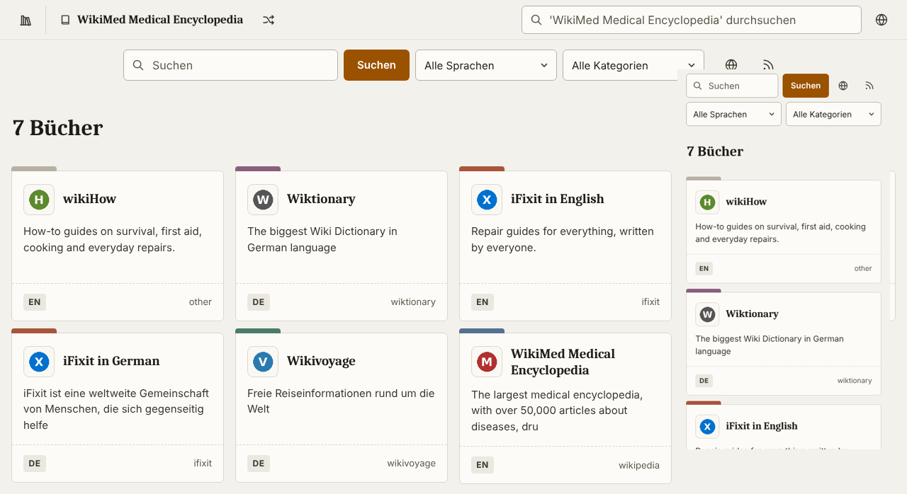
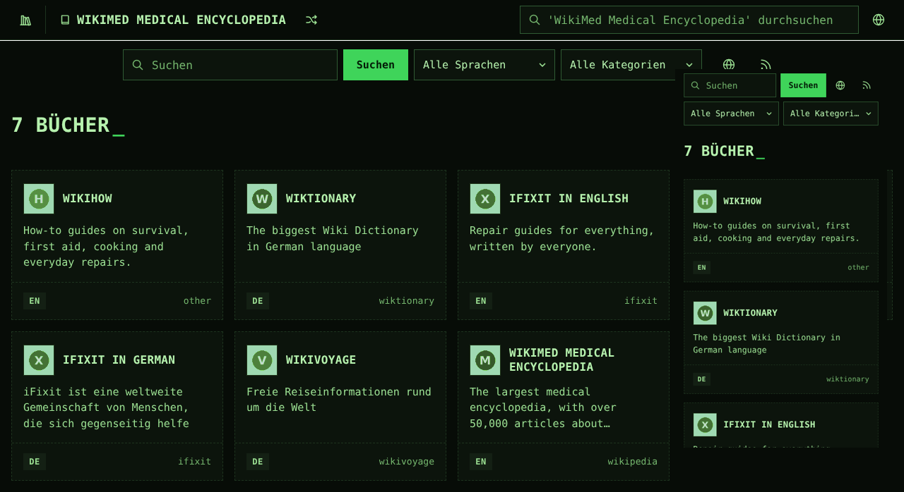

# offline-shelf

Unofficial offline themes for [kiwix-serve](https://github.com/kiwix/kiwix-tools), the
web server that serves Wikipedia and other ZIM archives without internet.

> This is a community project. It is not affiliated with or endorsed by the
> Kiwix project.

## Goals

- **Fully offline.** Once the repository is on your machine, nothing is ever
  downloaded at runtime. Themes must not reference web fonts, CDNs or any
  external URL.
- **No extra software.** No proxy, no fork, no rebuild of Kiwix. Themes use a
  mechanism kiwix-serve already ships.
- **Small.** A pack is three CSS files, about 42 KB together, with system
  fonts only. Runs fine on a Raspberry Pi and on old phones.

## How it works

kiwix-serve reads the environment variable `KIWIX_SERVE_CUSTOMIZED_RESOURCES`.
It points to a text file where each line maps a URL to a local file:

```
/skin/index.css text/css /themes/skin/index.css
```

kiwix-serve then serves that file instead of its built-in one. Details and
caveats are in [docs/how-it-works.md](docs/how-it-works.md).

This repository replaces three files: `kiwix.css` (loaded on every page),
`index.css` (library page) and `taskbar.css` (the toolbar above an opened
book). The layout lives once in [base/](base/). Each theme is a single
`themes/<name>/theme.css` holding only colours, fonts and shapes as CSS
custom properties, plus a few extra rules where a theme needs them.

## Pick your themes

You choose **one theme for light devices and one for dark devices**. Every
phone or computer then gets the one that matches its own light or dark
setting, with no switch and no JavaScript. The 25 combinations are prebuilt in
[dist/](dist/) as `dist/<light>+<dark>/`.

With Docker, mount `dist/` and point the variable at a pack:

```yaml
volumes:
  - ./offline-shelf/dist:/themes:ro
environment:
  KIWIX_SERVE_CUSTOMIZED_RESOURCES: /themes/papier+lampenlicht/resources.txt
```

Change the pack name, then `docker compose up -d kiwix` (kiwix-serve reads the
file at startup). A complete file is in
[examples/docker-compose.yml](examples/docker-compose.yml). Without Docker, run
`tools/kiwix-theme build-all /path/to/offline-shelf/dist` first, so the paths
in `resources.txt` exist on your machine.

To return to the stock look, remove the variable and restart kiwix-serve.

### Switch with one command

[examples/theme.sh](examples/theme.sh) keeps the choice in a `.env` file
next to `docker-compose.yml`. Copy `dist/` to `./themes/offline-shelf/`, use
this line in the compose file

```yaml
KIWIX_SERVE_CUSTOMIZED_RESOURCES: /themes/offline-shelf/${KIWIX_THEME:-papier+lampenlicht}/resources.txt
```

and switch on the server:

```sh
./theme.sh                    # show the active pack and all themes
./theme.sh zeitung rotlicht   # light theme first, dark theme second
./theme.sh off                # stock Kiwix look
```

## Themes

### Light

| Theme | Look |
| ----- | ---- |
| [Papier](themes/papier/) | Warm paper, near-black ink, serif titles, coloured index tabs per collection |
| [Atlas](themes/atlas/) | Cool map paper with a faint graticule, petrol accent, spaced capital titles, monospace details |
| [Zeitung](themes/zeitung/) | Newsprint: black on white, square, heavy serif headlines, red accent, greyscale logos |
| [Werkstatt](themes/werkstatt/) | Workshop grey, heavy 2px outlines, blueprint blue, monospace labels |
| [Salbei](themes/salbei/) | Sage green, round shapes and logos, rounded type |

### Dark

| Theme | Look |
| ----- | ---- |
| [Lampenlicht](themes/lampenlicht/) | Warm black, cream text, amber accent, coloured index tabs |
| [Bunker](themes/bunker/) | Phosphor terminal: black-green, monospace everywhere, dashed outlines, blinking cursor |
| [Mitternacht](themes/mitternacht/) | Night blue, ivory text, gold accent, italic serif titles |
| [Signal](themes/signal/) | Charcoal with safety orange, bold capitals, hazard-striped tabs |
| [Rotlicht](themes/rotlicht/) | Night vision for blackouts: black and dim red only, the article is tinted red too |

Every theme covers the library page and the reader toolbar, and the text in
each meets WCAG AA contrast (4.5:1 or more). Each folder has a `preview.png`.




**About the article itself.** The page below the toolbar is the book's own
HTML from the ZIM file, with its own styles and, for most Wikimedia books,
its own dark mode that follows the device. Themes do not restyle it. The one
exception is Rotlicht, which tints the whole article red with a CSS filter so
your eyes keep their dark adaptation. On books without a dark mode this gives
a red page rather than a dark one.

## Make a theme

Copy a folder in `themes/`, change the values in its `theme.css` (every colour
token listed in `tools/kiwix-theme` must be defined), then:

```sh
tools/kiwix-theme check                    # all colour tokens present?
tools/kiwix-theme build mytheme lampenlicht
tools/kiwix-theme check-server http://localhost:8080 mytheme+lampenlicht
```

The first line of `theme.css` carries the name, the scheme (`light` or
`dark`) and a one-line description. Rules after the `:root` block are extras
and only apply while that theme is active. The helper is a plain POSIX shell
script; it is only needed to build packs, not to run them.

## Compatibility

| kiwix-serve | libkiwix | Mechanism works |
| ----------- | -------- | --------------- |
| 3.5.0       | 12.1.1   | yes (tested)    |
| 3.8.2 (Docker image) | 14.x | yes, all themes tested against libkiwix 14.2.1 pages |
| latest      | 15.x     | present in source, not yet tested end to end |

Stock CSS changes between Kiwix releases. The themes were built against the
libkiwix 14.x page markup.

## License

GPL-3.0-or-later, the same license as Kiwix. Themes are usually derived from
Kiwix's own CSS, so they inherit its license.
