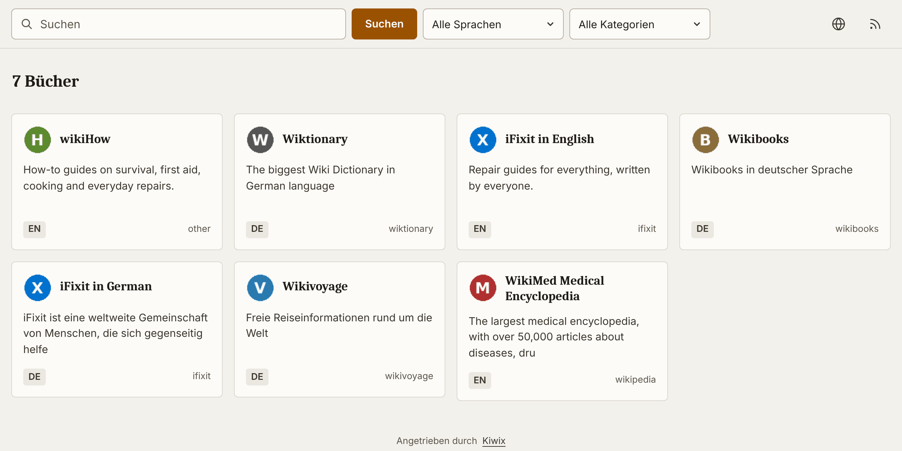
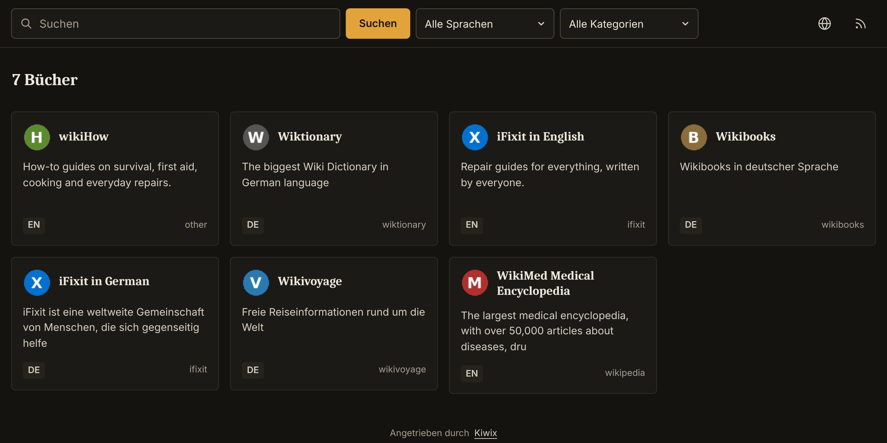
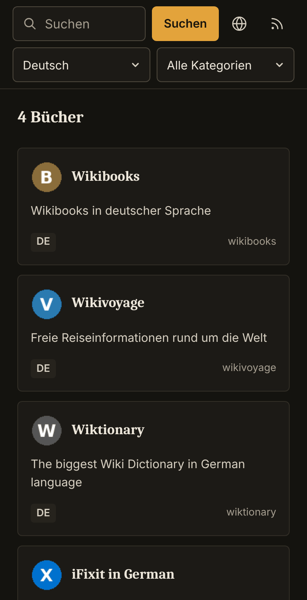

# Kartei

A quiet library theme for the kiwix-serve welcome page, named after the
library card index. Warm paper by day, a lamp-lit desk by night: it follows
the light or dark setting of the device, with no switch and no JavaScript.

| Light | Dark |
| --- | --- |
|  |  |
|  |  |

Stock look for comparison: [screenshots/stock-desktop.png](screenshots/stock-desktop.png).

## What it changes

- **Weight.** Drops the two stock web fonts (about 317 KB). Titles use the
  device's serif, everything else its UI sans. The library page goes from
  about 450 KB to about 135 KB on first load, JavaScript included.
- **Top bar.** One row on wide screens: search, button, both filters, icons.
  Two rows on tablets and phones, about 113 px high instead of 211 px.
- **Cards.** 300 px wide, content-sized, title in serif, three lines of
  description, language and tag at the foot. On phones they span the width.
- **States.** Visible keyboard focus around the whole card, hover and press
  feedback, an active filter is tinted, the tag filter shows as a removable
  chip. Motion stays under 220 ms and switches off with reduced motion.
- **Contrast.** All text at least 6.3:1 in both schemes (WCAG AA needs 4.5:1).

## Files

| URL | Purpose |
| --- | --- |
| `/skin/kiwix.css` | Colour tokens for both schemes, base styles, modal, loader |
| `/skin/index.css` | Library page layout |
| `/skin/langSelector.svg`, `/skin/feed.svg` | Line icons that switch colour with the scheme |

## Metadata

- Name: Kartei
- Tested with: kiwix-serve on libkiwix 14.0.0 to 14.2.1 (identical page files), Chromium, desktop and phone widths
- Not yet styled: article toolbar, search results, error pages (stock look)
- License: GPL-3.0-or-later
