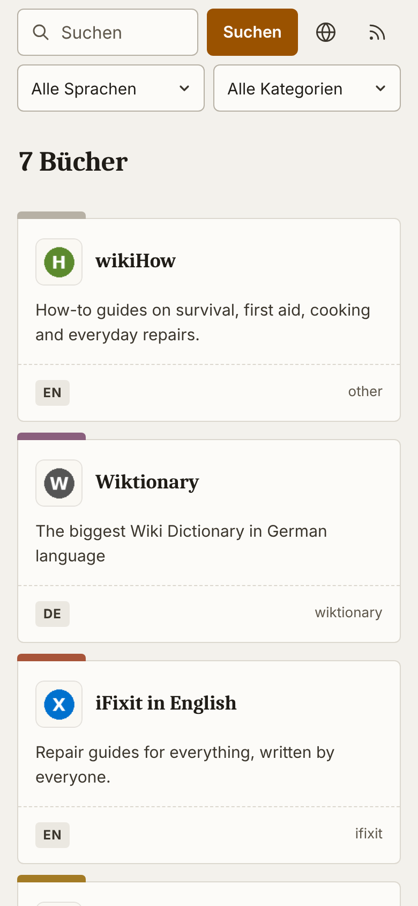

# Kartei

A quiet library theme for the kiwix-serve welcome page, named after the
library card index. Warm paper by day, a lamp-lit desk by night: it follows
the light or dark setting of the device, with no switch and no JavaScript.

| Light | Dark |
| --- | --- |
|  |  |
|  |  |

Reader toolbar: [dark, desktop](screenshots/reader-dark.png), [light, phone](screenshots/reader-mobile-light.png).

Stock look for comparison: [screenshots/stock-desktop.png](screenshots/stock-desktop.png).

## What it changes

- **Weight.** Drops the two stock web fonts (about 317 KB). Titles use the
  device's serif, everything else its UI sans. The library page goes from
  about 450 KB to about 140 KB on first load, JavaScript included.
- **Layout.** The top bar lines up with the card grid at every width, and the
  grid stops at five columns so wide screens stay calm. One row on wide
  screens, two rows on tablets and phones.
- **Index tabs.** Each card carries a small tab on its top edge, like a card
  in a library drawer, tinted by collection (Wikipedia, Wiktionary,
  Wikivoyage, Wikibooks, how-to guides, Gutenberg, Q&A, video). Unknown
  collections get a neutral tab.
- **Cards.** 300 px wide, logo on a small paper tile so dark logos stay
  readable in dark mode, title in serif, three lines of description,
  language and tag below a dashed rule. On phones they span the width.
- **Motion.** Cards rise in once, staggered over the first rows. On hover a
  card lifts, its tab grows and the title takes the accent colour. Press
  feedback on cards and buttons, a soft ring on focused fields, the top bar
  gains its edge only once the page scrolls, and opening a book cross-fades
  in browsers that support view transitions. Everything is CSS, animates
  only transform and opacity, stays under 330 ms and switches off with
  reduced motion.
- **States.** Visible keyboard focus around the whole card, an active filter
  is tinted, the tag filter shows as a removable chip.
- **Reader toolbar.** The bar above an opened book matches the library:
  line icons instead of emoji (library, random article), the book's title in
  serif with a book icon, a proper search field with themed suggestions, and
  a divider between "library" and "this book". On phones the title becomes
  an icon, the buttons stay visible, and the search takes the whole row while
  typing. The article itself is the book's own HTML and keeps the book's own
  look (including its own dark mode, if it has one).
- **Contrast.** All text at least 6.3:1 in both schemes (WCAG AA needs 4.5:1).

## Files

| URL | Purpose |
| --- | --- |
| `/skin/kiwix.css` | Colour tokens for both schemes, base styles, modal, loader |
| `/skin/index.css` | Library page layout |
| `/skin/taskbar.css` | Reader toolbar above an opened book |
| `/skin/langSelector.svg`, `/skin/feed.svg` | Line icons that switch colour with the scheme |

## Metadata

- Name: Kartei
- Tested with: kiwix-serve on libkiwix 14.0.0 to 14.2.1 (identical page files), Chromium, 390 to 1920 px wide
- Progressive extras: collection tabs need `:has()`, the scroll edge needs scroll-driven animations, the page cross-fade needs view transitions; without them the page looks the same minus that detail
- Not yet styled: full-text search results, error pages (stock look)
- License: GPL-3.0-or-later
